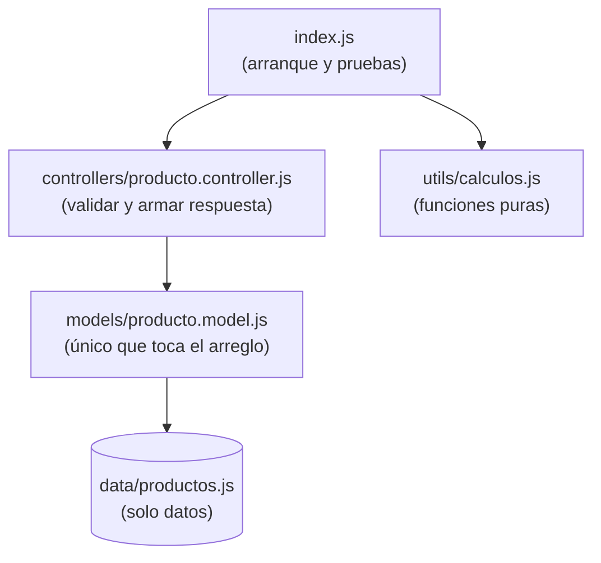
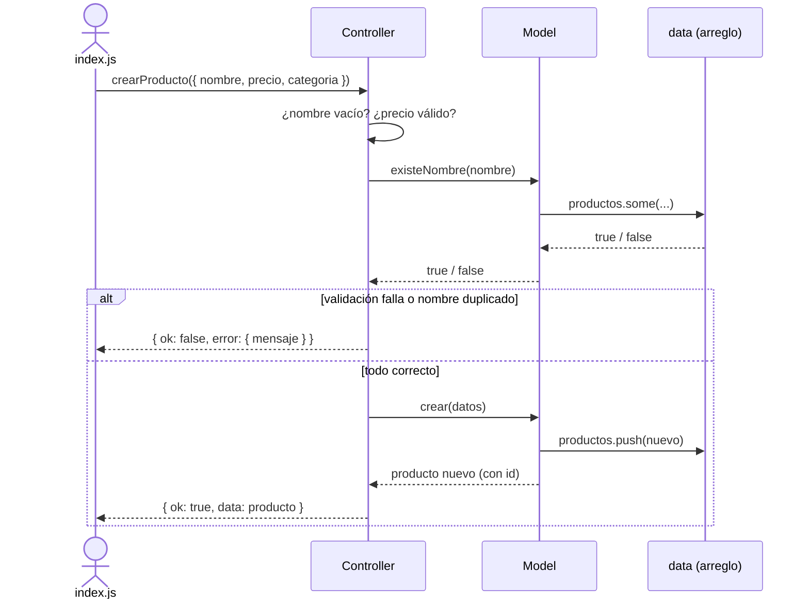
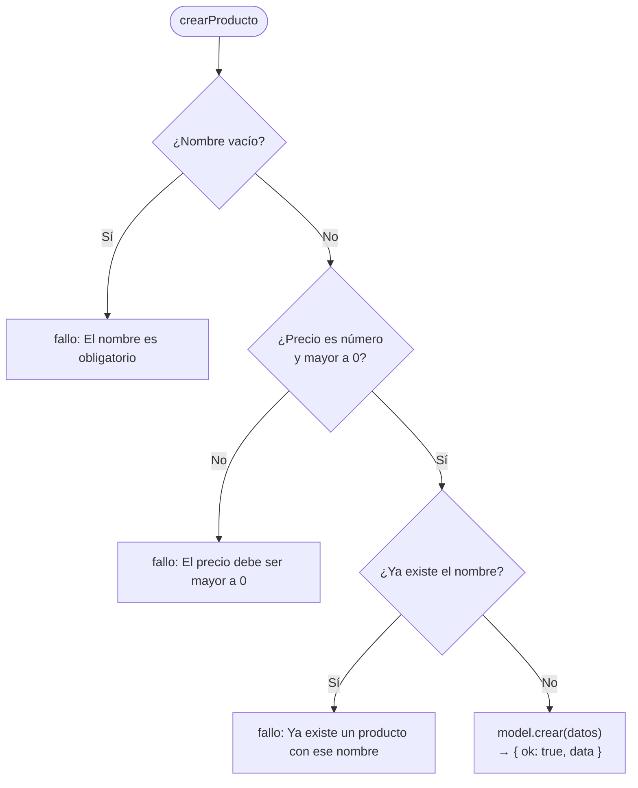
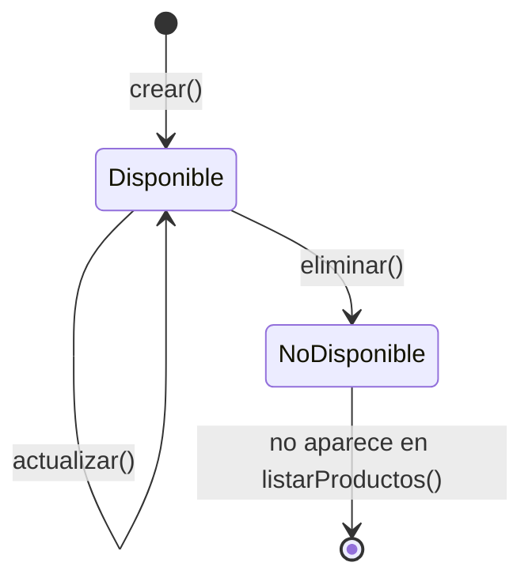

# 04.2 – Módulos: desmantelamiento (resultado esperado)

Solución de referencia del ejercicio **04.2 – Módulos y desmantelamiento**, de la asignatura *Aplica metodologías ágiles* (CBTis, 2026 – Semana 04).

El ejercicio parte de un único archivo que mezcla datos, reglas de negocio, acceso al arreglo y salida por consola. El objetivo es **desmantelarlo en módulos** con una responsabilidad clara cada uno, sin cambiar el comportamiento del programa.

> Esta carpeta contiene el **resultado esperado**. Intenta resolver el ejercicio por tu cuenta antes de consultarla.

## Objetivos de aprendizaje

- Separar un programa en módulos con **una sola responsabilidad**.
- Usar `import` / `export` con ES Modules.
- Aplicar una arquitectura en capas simple: **datos → model → controller → punto de entrada**.
- Definir un **contrato de respuesta** uniforme entre capas.
- Distinguir lógica de negocio de utilidades puras.

## Requisitos

- [Node.js](https://nodejs.org/) **19 o superior** (se usa `crypto.randomUUID()` como global).
- No requiere instalar dependencias.

## Cómo ejecutarlo

```bash
node index.js
```

El script recorre los casos principales: listar, crear, crear un duplicado, ver uno existente y uno inexistente, eliminar y calcular el total de un pedido.

## Estructura del proyecto

```text
.
├── index.js                          # Arranca y prueba. Sin lógica de negocio
├── package.json                      # "type": "module" (ES Modules)
└── src/
    ├── data/
    │   └── productos.js              # Solo datos
    ├── models/
    │   └── producto.model.js         # Único módulo que toca el arreglo
    ├── controllers/
    │   └── producto.controller.js    # Validaciones y armado de la respuesta
    └── utils/
        └── calculos.js               # Funciones puras de cálculo y formato
```

## Responsabilidad de cada módulo

| Módulo | Responsabilidad | Lo que **no** hace |
| --- | --- | --- |
| `data/productos.js` | Exportar el arreglo inicial de productos. | No contiene lógica. |
| `models/producto.model.js` | Leer y modificar el arreglo (listar, buscar, crear, actualizar, eliminar). | No valida ni arma respuestas (`ok`, `data`, `error`). |
| `controllers/producto.controller.js` | Validar la entrada, llamar al model y construir la respuesta. | No accede directamente al arreglo. |
| `utils/calculos.js` | Calcular totales y dar formato a precios. | No conoce productos ni respuestas. |
| `index.js` | Arrancar la aplicación y probar el flujo. | No tiene lógica de negocio. |

### Flujo de dependencias



Cada capa solo conoce a la de abajo. Si cambias cómo se almacenan los datos, solo se modifica el *model*.

### Secuencia: crear un producto

Qué ocurre cuando `index.js` llama a `crearProducto(...)`:



### Decisiones de `crearProducto`



### Ciclo de vida de un producto

La eliminación es lógica: el registro permanece en el arreglo, solo cambia `disponible`.



## Contrato de respuesta

Todas las funciones del controlador devuelven la misma forma:

```js
// Éxito
{ ok: true, data: /* resultado */ }

// Fallo
{ ok: false, error: { mensaje: "Descripción del problema" } }
```

## API de los módulos

### Controller

| Función | Descripción | Errores posibles |
| --- | --- | --- |
| `listarProductos()` | Lista los productos disponibles. | — |
| `verProducto(id)` | Devuelve un producto por `id`. | `Producto no encontrado` |
| `crearProducto(datos)` | Crea un producto (`nombre`, `precio`, `categoria`). | Nombre vacío, precio no numérico o ≤ 0, nombre duplicado |
| `actualizarProducto(id, cambios)` | Actualiza campos de un producto. | `Producto no encontrado` |
| `eliminarProducto(id)` | Elimina un producto. | `Producto no encontrado` |

### Utils

| Función | Descripción |
| --- | --- |
| `calcularTotal(pedido)` | Suma `precio × cantidad` de cada ítem del pedido. |
| `formatearPrecio(monto)` | Devuelve el monto como texto, por ejemplo `"$78.00"`. |

## Decisiones de diseño

- **Eliminación lógica.** `eliminar` marca `disponible = false` en lugar de borrar el registro; por eso `listarProductos` ya no lo muestra.
- **Duplicados sin distinguir mayúsculas.** `existeNombre` compara en minúsculas, así que `"Sincronizada"` y `"sincronizada"` cuentan como el mismo producto.
- **IDs generados con `crypto.randomUUID()`** para los productos nuevos.
- **Funciones puras en `utils`.** No dependen de estado externo, por lo que son fáciles de probar y reutilizar.

## Preguntas para reflexionar

1. ¿Qué módulo tendrías que modificar si los productos se guardaran en una base de datos en lugar de un arreglo?
2. ¿Por qué el *controller* no debería manipular el arreglo directamente?
3. ¿Qué ventaja tiene que todas las respuestas compartan el mismo contrato `{ ok, data | error }`?
4. ¿Qué pasaría si `calculos.js` importara el *model*? ¿Qué se perdería?

## Autor

Material didáctico elaborado por **sergiodev3** para el curso *Aplica metodologías ágiles* – CBTis, 2026.
